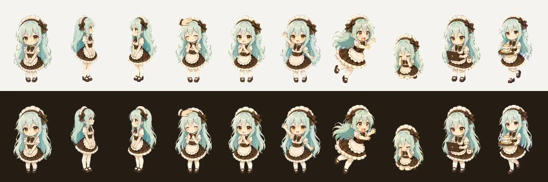

# Minty, web version

Minty is the mint-haired Café Shop maid from the banner, as a small pet that lives on the edge of a web page.
She is the web counterpart of the [Codex desktop pet](https://github.com/cafeshop-ai/minty): the same drawings,
re-cut for a page where she must stay out of the way.



- **Small:** about 33 x 57 CSS px on screen. Only a narrow pill over her body takes the pointer; the page around her
  stays clickable.
- **Light:**

  | File | Size |
  | --- | --- |
  | Atlas (`minty.avif`, 540x588, 29 frames) | 76 KB |
  | WebP fallback, only for browsers without AVIF | 86 KB |
  | Script | 4.4 KB gzipped |
  | Styles | 1.5 KB gzipped |

  No dependencies, no canvas or WebGL. Nothing animates frame by frame while she stands still, except an
  occasional blink.
- **Mouse only:** she never speaks.

## What she does

| You | Minty |
| --- | --- |
| Move the pointer near her | Notices it with wide eyes, and smiles while it is over her |
| Rub back and forth over her head, or click it | Head pat: closed-eye smile and hearts, then a happy pose |
| Click her body | Waves |
| Click her five times in a row | Crouches and sobs for a moment; a pat cheers her up sooner |
| Drag her | Struggles, facing the way you pull, and swings with the speed |
| Let go or throw | Falls, bounces off the sides, slides to a stop; a hard landing leaves her dizzy |
| Drop her on the menu | Tucks herself away behind it |
| Leave her alone | Blinks and breathes, and now and then smiles, waves or works on a laptop. After 90 s without input she dozes off |
| Click the small button over her head | Waves goodbye, runs to the menu edge in little hops and hides behind it; half her face and her bow peek out |
| Hover or click the peek | She leans out further and smiles; a click brings her back to where she stood |

The state (hidden, and where she stood) goes to `onChange`, so a page can keep it. With
`prefers-reduced-motion`, pass `reducedMotion: true`. She then has no breathing, blinking, idles, particles or
flights, and changes pose only when you act.

## Use

```ts
import { createMinty } from './dist/minty.js' // or src/minty.ts in a TypeScript build
import './dist/minty.css'
import manifest from './dist/minty.json'

const minty = await createMinty({
  sheet: { avif: '/minty.avif', webp: '/minty.webp' },
  manifest,
  edge: () => document.querySelector('nav')!.getBoundingClientRect().right, // the line she hides behind
  state: JSON.parse(localStorage.getItem('minty') || '{}'),
  reducedMotion: matchMedia('(prefers-reduced-motion: reduce)').matches,
  onChange: (state) => localStorage.setItem('minty', JSON.stringify(state)),
  labels: { hide: 'Hide Minty', summon: 'Call Minty' },
})
// minty.hide(), minty.summon(), minty.hidden; minty.relayout() when the edge moves; minty.destroy()
```

She is meant for a desktop page with a mouse. Leave her out on touch screens and narrow windows, for example
behind `matchMedia('(hover: hover) and (pointer: fine) and (min-width: 1024px)')`. Her layer uses `z-index: 45`:
above a sidebar at 40, below popovers and dialogs. Change it with `zIndex`.

`demo/index.html` shows her beside a sidebar that folds, in both themes. Serve the repository root and open
`/demo/`.

## How the atlas is made

`scripts/build-atlas.mjs` builds `dist/` from `spritesheet.webp` of
[cafeshop-ai/minty](https://github.com/cafeshop-ai/minty) at `dbab7c6b`. The script checks its SHA-256 first.

1. **Pick:** 29 of the source's 69 frames. Breathing and hops are drawn in code instead, and near-duplicate frames
   are dropped. The look directions (rows 9 and 10) and the coffee walk (row 6) are left out: they draw her with a
   smaller head on a longer body, so she would change size whenever she used them.
2. **Crop:** each frame to its own outline, keeping the point between her feet as its anchor.
3. **Scale:** each frame to the same head size, for 56 CSS px at 2x. The source draws some poses smaller than idle
   (head pats and sulks by about a ninth). `scripts/measure-heads.mjs` measures the front-facing rows. The drag
   rows lean too far for it and were measured by hand.
4. **Pack:** the frames into one sheet with 4 px gutters.
5. **Encode:** AVIF q48 (4:2:0), plus a WebP fallback. A 128-colour palette was smaller, but it lost her amber
   eyes, the blush and the brooch.

```sh
npm install
node scripts/measure-heads.mjs ../minty/spritesheet.webp # head sizes for HEADS in build-atlas.mjs (minutes)
node scripts/build-atlas.mjs ../minty/spritesheet.webp   # dist/minty.{avif,webp,json}
npm run build                                            # dist/minty.{js,css}
node scripts/preview.mjs                                 # preview.webp
npm run check                                            # tsc
```

## License

MIT, © 2026 Café Shop, like the desktop pet the drawings come from. See [LICENSE](LICENSE).
